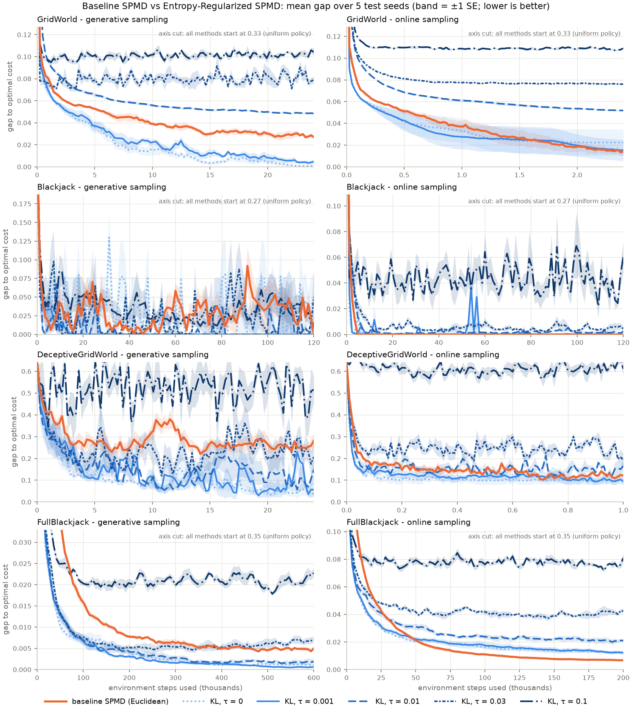
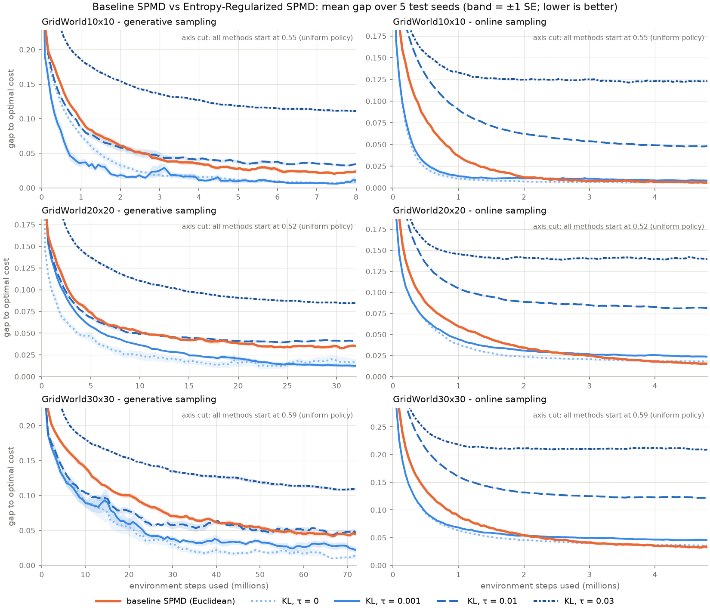

# Entropy-Regularized SPMD vs. baseline SPMD

**Baseline:** the team's SPMD (`utils.mirror_step`: Euclidean mirror step, generative Monte Carlo
Q estimates), which produced the team's saved baseline results.
**Enhancement:** SPMD with the KL mirror step and a negative-entropy regularizer of weight τ
(`pmd.py`).

## 1. Summary

With a small entropy weight (**τ = 0.001**), Entropy-Regularized SPMD **beats baseline SPMD in
6 of 14 settings**: every setting that uses the team's generative sampling, except the original
blackjack, where both reach the exact optimum. It **ties in 5** and is **worse in 3**: the larger
online problems (Full Blackjack, 20×20 and 30×30 GridWorld).
Larger weights do worse: τ = 0.01 beats the baseline in 1 of 14 settings, and τ ≥ 0.03 in none.

| Entropy weight | Better than baseline | Tie | Worse than baseline |
|---|---|---|---|
| τ = 0.001 | **6** | 5 | 3 |
| τ = 0.01 | 1 | 5 | 8 |
| τ = 0.03 | 0 | 2 | 12 |
| τ = 0.1 (8 settings) | 0 | 0 | 8 |
| *Ablation: τ = 0 (KL step, no entropy)* | *6* | *7* | *1* |

*Better*: z ≤ −2. *Worse*: z ≥ +2 and a gap difference of at least 0.001. Anything else is a
tie. z is the difference in mean final gap divided by its standard error (5 + 5 seeds).

**Where the improvement comes from.** The ablation row shows that the KL mirror step alone
(τ = 0) gets the same 6 wins. Adding the entropy term never gave a statistically clear gain over
τ = 0, and on larger boards with online sampling it made results worse (Section 7). The
improvement over the baseline is therefore due to the **KL mirror step**, not the entropy
regularizer.

> Note for the report: the proposal (Section 2, "Entropy-Regularized SPMD") says τ = 0 "recovers
> baseline SPMD". In the code the baseline is the team's Euclidean SPMD, so τ = 0 is plain *KL*
> SPMD, which is already an enhancement over that baseline. The proposal wording should be aligned
> with whichever baseline the team reports.

## 2. Methods compared

The SPMD subproblem at each state, with step size η and entropy weight τ (costs, lower is better):

$$
\pi_{k+1}(\cdot|s) = \arg\min_{p \in \Delta(A)} \; \eta\big[\langle \hat Q_\tau(s,\cdot), p\rangle + \tau \textstyle\sum_a p_a \log p_a\big] + D\big(p,\, \pi_k(\cdot|s)\big)
$$

- **Baseline SPMD:** $D(p, \pi_k) = \tfrac12\|p - \pi_k\|^2$, τ = 0. The update is the Euclidean
  projection of $\pi_k - \eta \hat Q$ onto the simplex.
- **Entropy-Regularized SPMD:** $D = \mathrm{KL}(p\,\|\,\pi_k)$, τ > 0. Closed form:
  $\pi_{k+1}(a|s) \propto \pi_k(a|s)^{\frac{1}{1+\eta\tau}} \exp\!\big(-\frac{\eta\, \hat Q_\tau(s,a)}{1+\eta\tau}\big)$.
  Implemented as `run_pmd(pi, -Q, step_size, tau)`; `run_pmd` maximizes, so cost-valued Q is negated.
- **Ablation, KL SPMD:** the same KL update with τ = 0.

**Costs.**
- *Training:* $\hat Q$ is a Monte Carlo average of discounted returns (γ = 0.9). For τ > 0, every
  step's cost gets an extra $\tau \sum_a \pi(a|s)\log\pi(a|s)$ (negative entropy, at most 0),
  so more random policies cost less. That makes $\hat Q_\tau$ the regularized Q of the
  entropy-regularized MDP (`EntropyCostEnv` in `kl_spmd.py`).
- *Reported:* the **unregularized** expected discounted cost from the start, computed **exactly**
  from each problem's model, $V^\pi = (I-\gamma P^\pi)^{-1}c^\pi$ (`exact_eval.py`). All results
  are the **gap to the optimal cost** (0 = optimal), with no scoring noise.

## 3. Problems and sampling

| Problem | States | Description | Optimal cost |
|---|---|---|---|
| GridWorld (team) | 100 | 10×10, 3 goals, 10 hazards; cost 0.2 per step, 1 on hazards, 0 at goals; start at square 0 | 1.9533 |
| Blackjack (team) | 32 | cards 2–5, bust > 11, dealer to 9; win −1 / tie 0 / loss or bust +1; scored at hand (8, 3) | 0.2750 |
| Deceptive GridWorld | 144 | 12×12; a decoy exit 2 steps from start (lump cost 1) vs. a free goal 6 steps away behind 2 hazards; step costs get N(0, 1) noise | 1.1975 |
| Full Blackjack | 162 | cards 2–10 (10 four times as likely), bust > 21, dealer to 17; scored over the random deal | 0.0570 |
| GridWorld 10×10 / 20×20 / 30×30 | 100 / 400 / 900 | team rules and densities (3 % goals, 10 % hazards, random fixed layout); random start square, scored over all squares | 1.9168 / 1.9617 / 1.9473 |

In Deceptive GridWorld, settling for the decoy costs 1.334, a gap of 0.136; a final gap near 0.136
means the method got stuck at the decoy. The new problems are in `hard_problems.py`. The larger
GridWorlds start from a random square because, with a fixed corner start and γ = 0.9, only the
~10 moves near the corner affect the score, so extra states would not matter.

Q is estimated in one of two ways (`estimators.py`):
- **Generative** (the team's): rollouts start from *every* state and action, so every action is
  tried every iteration.
- **Online**: whole episodes from the start state(s), following the policy. Pairs the policy
  avoids are never sampled. An untried action at a visited state gets that state's average
  return; an unvisited state gets a constant row.

## 4. Protocol

- Step sizes: baseline 0.1, 0.5, 1 (the team's grid); KL methods 1, 5, 20. Cost gaps between
  actions are small, so the KL step needs larger step sizes to move the policy.
- Each method picks its step size by lowest mean exact cost on 3 tuning seeds, then is rerun on
  5 fresh test seeds. Every method gets the same training budget (environment steps) within a setting.
- Budgets: team GridWorld 24 M (generative) / 2.4 M (online); team blackjack 120 k / 120 k;
  Deceptive GridWorld 24 M / 1 M; Full Blackjack 600 k / 200 k. Larger GridWorlds: 100 full sweeps
  (generative; 8 M, 32 M, 72 M) and 4.8 M (online) at every size, so online gets less data per
  state on larger boards.

## 5. Results: original and harder problems

Final gap to optimal (mean of 5 test seeds; lower is better).
Δ = change vs. baseline for τ = 0.001 (negative = better than baseline).

| Problem | Sampling | **Baseline SPMD** | τ = 0.001 | τ = 0.01 | τ = 0.03 | τ = 0.1 | Δ (τ = 0.001) vs baseline | *KL, τ = 0* |
|---|---|---|---|---|---|---|---|---|
| GridWorld | generative | 0.0269 | **0.0047** | 0.0484 | 0.0789 | 0.1041 | −0.0222 (z = −8.4) ✔ | *0.0012* |
| GridWorld | online | **0.0141** | 0.0154 | 0.0517 | 0.0760 | 0.1090 | +0.0013 (z = +0.1) tie | *0.0224* |
| Blackjack | generative | **0.0000** | **0.0000** | 0.0159 | 0.0503 | 0.0098 | 0.0000 tie | *0.0460†* |
| Blackjack | online | **0.0000** | 0.0001 | 0.0023 | 0.0044 | 0.0601 | +0.0001 tie | *0.0000* |
| Deceptive GridWorld | generative | 0.2817 | **0.0559** | 0.1482 | 0.2069 | 0.5161 | −0.2258 (z = −5.1) ✔ | *0.0379* |
| Deceptive GridWorld | online | 0.1222 | **0.0945** | 0.1660 | 0.1921 | 0.6110 | −0.0277 (z = −1.4) tie | *0.0989* |
| Full Blackjack | generative | 0.0050 | **0.0006** | 0.0019 | 0.0070 | 0.0228 | −0.0044 (z = −10.3) ✔ | *0.0011* |
| Full Blackjack | online | **0.0067** | 0.0122 | 0.0211 | 0.0425 | 0.0808 | +0.0055 (z = +3.9) ✘ | *0.0125* |

† Tuning chose step size 20 for τ = 0 here, which failed on 2 of 5 test seeds. With step size 1 or
5 it reaches the exact optimum on all 10 seeds (Section 8).

Highlights:
- **Deceptive GridWorld, generative:** the baseline ends *worse than the decoy* (0.282 vs. 0.136),
  while Entropy-Regularized SPMD with τ = 0.001 reaches 0.056.
- **Online sampling** is where the enhancement does not help: ties on the original problems, and
  worse on Full Blackjack.
- Learning speed (gaps at 25 % and 50 % of the budget are in `exploration_results.csv`) follows
  the final results. For example, GridWorld generative at 25 % budget: baseline 0.0488 vs.
  τ = 0.001 0.0314.

**Learning curves.** Mean exact gap after every iteration over the 5 test seeds (band = ±1 SE),
for baseline SPMD (orange) and each τ (blue, darker = larger τ). The y-axes are cut so the late
differences are visible; every method starts at the uniform policy's gap, noted in each panel.



- The curves show what the final numbers alone do not. τ ≥ 0.01 stops improving early and
  plateaus at a fixed bias (flat lines), as expected for a fixed entropy weight. τ = 0.001 and
  τ = 0 track each other almost everywhere.
- Online GridWorld and Full Blackjack: the KL methods drop faster early, but the baseline catches
  up (GridWorld) or overtakes them (Full Blackjack, after about 50 k steps).
- Blackjack generative is noisy for every method, so its final-point verdicts are fragile.

## 6. Results: larger GridWorlds

| Board | Sampling | **Baseline SPMD** | τ = 0.001 | τ = 0.01 | τ = 0.03 | Δ (τ = 0.001) vs baseline | *KL, τ = 0* |
|---|---|---|---|---|---|---|---|
| 10×10 | generative | 0.0236 | **0.0111** | 0.0342 | 0.1111 | −0.0125 (z = −2.1) ✔ | *0.0084* |
| 10×10 | online | **0.0061** | 0.0084 | 0.0482 | 0.1233 | +0.0022 (z = +1.8) tie | *0.0058* |
| 20×20 | generative | 0.0351 | **0.0123** | 0.0406 | 0.0846 | −0.0228 (z = −9.8) ✔ | *0.0163* |
| 20×20 | online | **0.0152** | 0.0236 | 0.0814 | 0.1393 | +0.0085 (z = +7.4) ✘ | *0.0179* |
| 30×30 | generative | 0.0446 | **0.0215** | 0.0462 | 0.1093 | −0.0230 (z = −4.5) ✔ | *0.0134* |
| 30×30 | online | **0.0326** | 0.0457 | 0.1220 | 0.2091 | +0.0132 (z = +12.0) ✘ | *0.0356* |

- **Generative:** Entropy-Regularized SPMD (τ = 0.001) roughly halves the baseline's gap at every
  size. The baseline's gap grows with board size (0.024 → 0.035 → 0.045); the enhancement's stays
  near 0.01–0.02.
- **Online:** the enhancement falls further behind the baseline as the board grows (+0.002 →
  +0.009 → +0.013), and larger τ is much worse (τ = 0.01: +0.042 → +0.066 → +0.089).
- A likely reason, partly from our design: online, many squares get no visits in an iteration
  and receive a constant Q row. With τ > 0 the regularized update pulls those squares back toward
  uniform every iteration (the baseline and τ = 0 leave them unchanged). Larger boards have more
  such squares, and all of them count in the score. Skipping the update for unvisited squares
  could change this result.


- Online, τ = 0.001 is ahead of the baseline for about the first 2 M steps on every board, then
  the baseline crosses below it and keeps improving while τ = 0.001 flattens.
- Tuning picked step size 20 (the largest tried) for 10×10 generative τ = 0.001 and 20×20
  generative τ = 0; elsewhere chosen step sizes were inside the grid.

## 7. Ablation: KL step vs. entropy term

Change in final gap from adding entropy to KL SPMD (vs. τ = 0; negative = entropy helped):

| Setting | τ = 0.001 | τ = 0.01 |
|---|---|---|
| GridWorld generative / online | +0.0035 (z = +1.6) / −0.0069 (z = −0.4) | +0.047 (z = +49) / +0.029 (z = +2.4) |
| Blackjack generative / online | −0.0460 (z = −1.3)† / +0.0001 | −0.0301 (z = −0.8)† / +0.0023 (z = +1.6) |
| Deceptive generative / online | +0.0180 (z = +0.5) / −0.0044 (z = −0.2) | +0.110 (z = +1.7) / +0.067 (z = +2.1) |
| Full Blackjack generative / online | −0.0005 (z = −1.5) / −0.0003 (z = −0.2) | +0.0008 (z = +1.2) / +0.0085 (z = +5.5) |
| 10×10 generative / online | +0.0028 (z = +0.5) / +0.0025 (z = +1.7) | +0.026 (z = +14) / +0.042 (z = +37) |
| 20×20 generative / online | −0.0039 (z = −0.9) / +0.0057 (z = +2.9) | +0.024 (z = +6.3) / +0.063 (z = +36) |
| 30×30 generative / online | +0.0082 (z = +1.3) / +0.0101 (z = +6.2) | +0.033 (z = +5.8) / +0.086 (z = +47) |

No entropy gain over τ = 0 reaches z ≤ −2; many losses do. So the entropy term contributes no
measurable improvement, and the KL mirror step accounts for the gain over the baseline.

## 8. Earlier experiments with the team pipeline

These used the team's own `train()` (generative sampling, full budgets) with only the update swapped:
- **GridWorld, 5 seeds, 24 M steps** (true cost; optimal 1.9533): baseline SPMD 1.9973 ± 0.011;
  KL τ = 0 (step 5) 1.9555 ± 0.003; τ = 0.001 (step 5) 1.9573 ± 0.004; τ = 0.003 (step 20)
  1.9966 ± 0.005. τ = 0.001 roughly doubled final policy entropy (0.05 → 0.11 nats).
- **Blackjack, 10 seeds, exact scoring:** KL with step size 1 or 5 (τ = 0, or τ = 0.01 at step 1)
  found the exact optimal policy on every seed; τ ≥ 0.03 was worse. The team's saved baseline
  policy has exact cost 0.2769 at (8, 3) vs. optimal 0.2750.
- The team's sampled blackjack score has a standard error of about ±0.027, larger than these
  differences, so blackjack comparisons need exact scoring.

The scripts for this section were exploratory and are not in the repo. `gridworld_kl_spmd.py` and
`blackjack_kl_spmd.py` reproduce single runs.

## 9. Interpretation

- **Against the baseline, the enhancement wins under the team's generative sampling.** The KL
  step changes the policy multiplicatively and smoothly, which averages out noisy Q estimates.
  The Euclidean step can jump to whichever action looks best under one noisy estimate; on the
  noisy Deceptive GridWorld that leaves it worse than the decoy.
- **The entropy term itself does not help.** A fixed τ trades exploration for a permanently biased
  policy (the regularized optimum is softmax(−Q/τ)). With γ = 0.9 and small cost gaps between
  actions, a τ large enough to keep the policy noticeably random costs more than it gains.
- **Generative sampling already explores**, removing the main reason to keep the policy random.
  Online sampling, where exploration should matter, did not reverse the conclusion.

## 10. Limitations

- 5 test seeds and a coarse step-size grid; differences below about 0.01 are not meaningful.
- Step size is tuned per method; τ was swept, not tuned jointly with rollouts and horizon.
- Deceptive GridWorld's layout and decoy cost, the random-start scoring for larger GridWorlds,
  and the online estimator's handling of unvisited pairs are our design choices
  (`hard_problems.py`, `estimators.py`).
- Only a fixed τ was tested. The proposal's annealed schedule τ_k = τ₀/(k+1)^p, which keeps early
  exploration without the final bias, has not been run yet and is the natural next experiment.

## 11. Reproduce

From `IE-692-RL-Project/`:

```bash
python "Entropy-Regularized SPMD/test_pmd.py"             # update rule: 26/27 pass (zero-probability test fails by design of the 1e-8 floor)
python "Entropy-Regularized SPMD/test_hard_problems.py"   # problems, exact scoring, estimators: 7/7
python "Entropy-Regularized SPMD/compare_exploration.py" --output new_results.csv   # Section 5, ~11 min
python "Entropy-Regularized SPMD/compare_exploration.py" --problems GridWorld10x10 GridWorld20x20 GridWorld30x30 \
    --taus 0 0.001 0.01 0.03 --output new_larger.csv                                 # Section 6, ~15 min
python "Entropy-Regularized SPMD/plot_trajectories.py"          # learning-curve figures, ~10 min (--plot-only to replot)
python "Entropy-Regularized SPMD/gridworld_kl_spmd.py" --tau 0.001 --output gw_run   # team pipeline, GridWorld
python "Entropy-Regularized SPMD/blackjack_kl_spmd.py" --tau 0.01 --output bj_run    # team pipeline, blackjack
```

Raw results: `exploration_results.csv` (Section 5) and `larger_gridworld_results.csv` (Section 6);
per-iteration curves in `trajectories.npz`.
