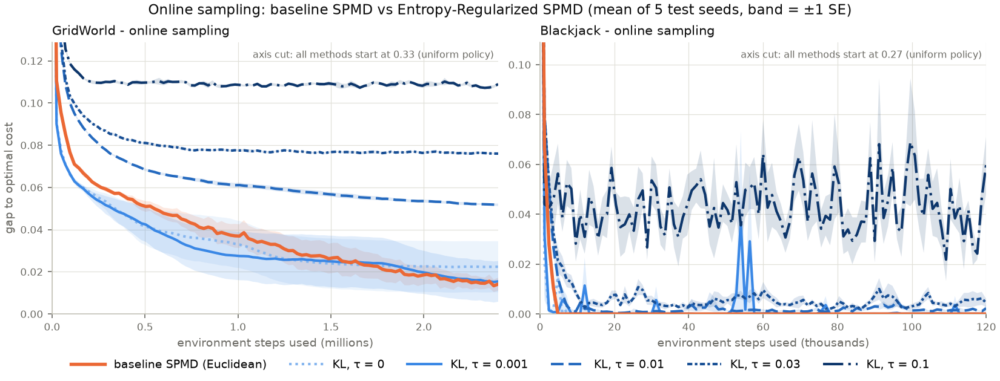

# Entropy-Regularized SPMD: reproducing the online learning curves

This folder compares the team's **baseline SPMD** (Euclidean mirror step, `utils.mirror_step`)
with **Entropy-Regularized SPMD** (KL mirror step with entropy weight τ, `pmd.run_pmd`) on
GridWorld and blackjack with **online sampling**. The output is `trajectories_online.png`, the
learning curve of every method. Full results for all problems are in `ENTROPY_RESULTS.md`.



## Requirements

- The full repository: the scripts import the team's `utils.py`, `baseline.py` and
  `baseline_blackjack.py` from the parent folder.
- Python 3 with NumPy and Matplotlib 3.7 or newer. Tested with Python 3.12, NumPy 2.5 and
  Matplotlib 3.11.

## Reproduce the figure (about 1 minute)

From the repository root, `IE-692-RL-Project/`:

```bash
python "Entropy-Regularized SPMD/plot_trajectories.py" --online-only
```

This reruns all 6 methods × 5 test seeds and writes two files to this folder:

- `trajectories_online.npz`: the gap to the optimal cost after every iteration, per method and seed.
- `trajectories_online.png`: the figure.

To redraw the figure from the saved curves without rerunning:

```bash
python "Entropy-Regularized SPMD/plot_trajectories.py" --online-only --plot-only
```

The runs are seeded, so you should see exactly these final gaps (also printed while running):

| Method | Step size | GridWorld final gap | Blackjack final gap |
|---|---|---|---|
| Baseline SPMD (Euclidean) | 0.5 / 0.5 | 0.0141 | 0.0000 |
| KL, τ = 0 | 5 / 5 | 0.0224 | 0.0000 |
| KL, τ = 0.001 | 5 / 5 | 0.0154 | 0.0001 |
| KL, τ = 0.01 | 1 / 1 | 0.0517 | 0.0023 |
| KL, τ = 0.03 | 1 / 1 | 0.0760 | 0.0044 |
| KL, τ = 0.1 | 1 / 5 | 0.1090 | 0.0601 |

Step sizes are listed as GridWorld / Blackjack.

## Reproduce from scratch, including step-size tuning

The step sizes above were tuned by `compare_exploration.py` and are read from
`exploration_results.csv`. To redo the tuning too:

```bash
python "Entropy-Regularized SPMD/compare_exploration.py" --problems GridWorld Blackjack \
    --output "Entropy-Regularized SPMD/tuned_gw_bj.csv"
python "Entropy-Regularized SPMD/plot_trajectories.py" --online-only \
    --tuned "Entropy-Regularized SPMD/tuned_gw_bj.csv"
```

`compare_exploration.py` refuses to overwrite an existing file, so choose a new `--output` name
each time. It also tunes the generative-sampling settings, which take most of its run time.

## What is run

| | GridWorld (team's 10×10 board) | Blackjack (team's simplified game) |
|---|---|---|
| Sampling | 100 episodes per iteration from the start state, horizon 80 | 200 episodes per iteration from the team's start hand (total 8, dealer card 3), horizon 8 |
| Training budget | 2,400,000 environment steps | 120,000 environment steps |
| Optimal cost from the start state (γ = 0.9) | 1.9533 | 0.2750 |

- **Methods:** baseline SPMD (Euclidean step, tuned over step sizes 0.1, 0.5, 1) and the KL step
  with τ = 0, 0.001, 0.01, 0.03, 0.1 (tuned over step sizes 1, 5, 20). τ = 0 is plain KL SPMD
  with no entropy term.
- **Update (cost form):** π_{k+1}(a|s) ∝ π_k(a|s)^{1/(1+ητ)} · exp(−η Q̂(s,a) / (1+ητ)). With
  τ > 0, Q̂ is estimated with the entropy cost τ Σ_a π log π added to each step's cost
  (`kl_spmd.EntropyCostEnv`), so it is the regularized Q.
- **Online sampling** (`estimators.online_q`) plays whole episodes from the start state(s) and
  uses every-visit Monte Carlo returns:
  - An action not tried at a visited state gets that state's average return.
  - Every action at an unvisited state gets the same value, so the update leaves that state alone.
- **Protocol:** step sizes were chosen on tuning seeds 100–102. The curves use fresh test seeds
  200–204, starting from the uniform policy.
- **Scoring:** after every iteration the policy is scored **exactly** from the model
  (`exact_eval.ExactScorer`: V = (I − γP^π)⁻¹ c^π, start-state cost minus the optimal cost), so the
  curves have no evaluation noise. The figure shows the mean over the 5 seeds with a ±1
  standard-error band.

## Reading the figure

- **Y-axis cut:** each panel cuts the y-axis so the late differences are visible. All methods
  start at the uniform policy's gap (0.33 GridWorld, 0.27 blackjack), which is noted in the panel.
- **GridWorld:** τ = 0 and τ = 0.001 drop fastest, but the baseline catches up by about 1.5M
  steps and finishes level with τ = 0.001. τ ≥ 0.01 levels off at a fixed bias, and larger τ
  levels off higher.
- **Blackjack:** the baseline, τ = 0 and τ = 0.001 reach the optimal policy within about 5k
  steps. τ = 0.1 never settles.

## Files used

| File | Role |
|---|---|
| `plot_trajectories.py` | Runs the seeds and draws the figures (`--online-only`, `--plot-only`, `--tuned`) |
| `pmd.py` | `run_pmd`: the KL / entropy-regularized mirror step |
| `kl_spmd.py` | `EntropyCostEnv`: adds the entropy cost so the sampled Q is the regularized Q |
| `estimators.py` | `online_q` (on-policy episodes) and `generative_q` (team's sampler) |
| `exact_eval.py` | Exact models and exact policy scoring |
| `compare_exploration.py` | Problem settings, seeds and step-size tuning; writes `exploration_results.csv` |
| `../utils.py` | Team baseline: Euclidean `mirror_step` and helpers |

Checks: `python test_pmd.py` (update rule; 26/27 pass, and the zero-probability test fails because
of the deliberate 1e-8 floor) and `python test_hard_problems.py` (problems, exact scoring and
estimators; 7/7 pass). Run both from this folder.

Without `--online-only`, `plot_trajectories.py` reruns all 13 settings (about 10 minutes) and also
draws `trajectories_original.png` and `trajectories_larger_gridworld.png`.
