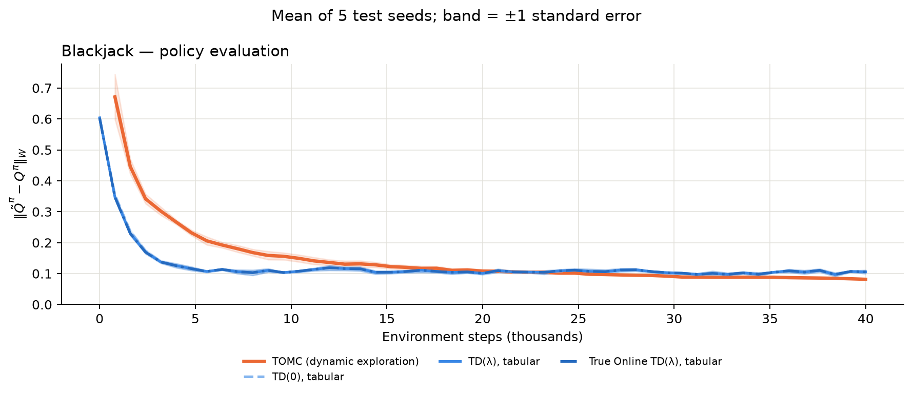

# Blackjack Policy Evaluation: reproducing the online learning curves

This folder compares **TOMC with dynamic exploration time**, **tabular TD(0)**, and
**tabular TD(λ)** under the same fixed uniform Blackjack policy. The output is one
figure showing evaluation error against environment steps. Start with
[`policy_eval.ipynb`](policy_eval.ipynb); it imports the method implementations.




## Requirements

- Python 3 with NumPy and Matplotlib.
- Jupyter or a notebook-capable editor using the project's Python environment.

## Reproduce the figure

From the folder, open the notebook:

```bash
jupyter notebook policy_evaluation_enhancements/policy_eval.ipynb
```

In **Choose what to run**, set:

```python
ENVIRONMENT = 'blackjack'
METHOD = 'blackjack_comparison'
TASK = 'evaluation'
TUNE = False
```

Select **Restart Kernel and Run All**. This runs exactly three methods × five test
seeds and draws one comparison figure. The notebook selects 40,000 moves per method
and seed for this task. GridWorld, linear features, and True Online TD are not part
of this selection.

To run the methods separately, repeat **Restart Kernel and Run All** with each name:

```python
METHOD = 'baseline'       # TOMC with dynamic exploration
METHOD = 'td_tabular_0'   # Basic tabular TD(0), lambda is fixed at zero
METHOD = 'td_tabular'     # Ordinary tabular TD(lambda)
```

Choose only one of these lines per run. Both TD methods use `td_tabular.py`;
TD(0) is its lambda-zero case. They save into different folders, so neither replaces
the other's results.

For a quick comparison using one repeat, set `SEEDS = [200]` for every method.
Use `SEEDS = TEST_SEEDS` for the five-seed figure with uncertainty bands.

To redraw only these three saved curves, run the imports cell, then this plotting
call in a notebook cell. This does not repeat learning:

```python
plot_results(
    'blackjack', 'evaluation', [200, 201, 202, 203, 204],
    methods=['baseline', 'td_tabular_0', 'td_tabular']
)
```

## Reproduce from scratch, including parameter tuning

Use the same notebook configuration with:

```python
TUNE = True
```

Run all cells. Each evaluator's settings are selected by its mean fixed-policy
error across tuning seeds 100, 101, and 102, then tested on fresh seeds 200–204.

- **TOMC:** try horizons 2, 3, and 4.
- **TD(0):** try learning rates 0.01, 0.05, and 0.1, keeping λ = 0.
- **TD(λ):** try learning rates 0.01, 0.05, and 0.1 with λ = 0.3, 0.6, and 0.9.

Tuning uses the notebook's `TUNING_STEPS` setting, then learning uses `N_STEPS`.
Tuning is optional and takes additional time. All three tuning seeds must produce
an estimate for a candidate to be eligible. If TOMC coverage is incomplete for all
candidates, its starting settings are retained and identified as such.

Each method saves `tuning.csv`, `tuning_means.csv`, and `parameters.json` under its
own Blackjack results folder. Once selected, keep `TUNE = False` to reuse settings.

## What is run

| | Blackjack |
|---|---|
| Environment | Simplified card game |
| Decision states / actions | 32 / 2: stop or draw |
| Policy evaluated | Uniform: each action has probability 0.5 |
| Discount factor | γ = 0.9 |
| Observation stream | Follow the policy; deal a fresh hand after termination |
| Test seeds | 200, 201, 202, 203, 204 |
| Figure | One panel, three curves, mean ±1 standard error |

- **TOMC:** collect first visits to the required state/action pairs and complete
  their truncated returns. Average completed coverage rounds under the fixed policy.
- **TD(0):** update the current state/action estimate after each transition.
- **TD(λ):** use the same one-step error with accumulating traces to update recent
  state/action estimates. Traces reset at the end of a hand.
- **Scoring:** compare learned action values with the exact values of the fixed
  policy, weighted by its state/action visitation frequencies. The model is used
  for scoring only; learning uses sampled moves.
- **Protocol:** reset the random generator for each seed. All three methods follow
  the same fixed policy and receive the same number of moves for each seed.

This figure measures **policy-evaluation error**. The entropy team's figure measures
the gap to optimal cost during policy improvement; those are different metrics.


